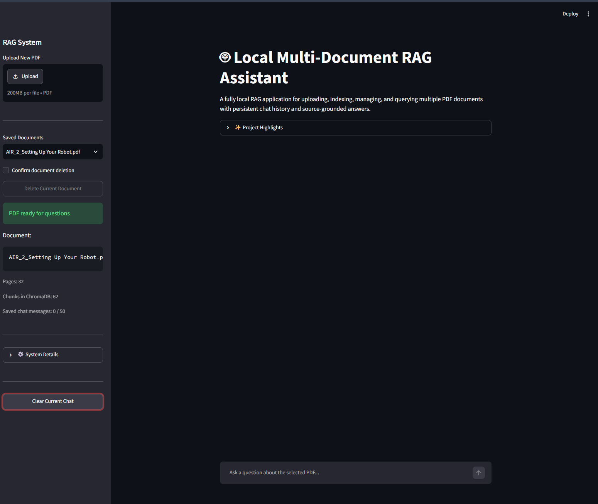
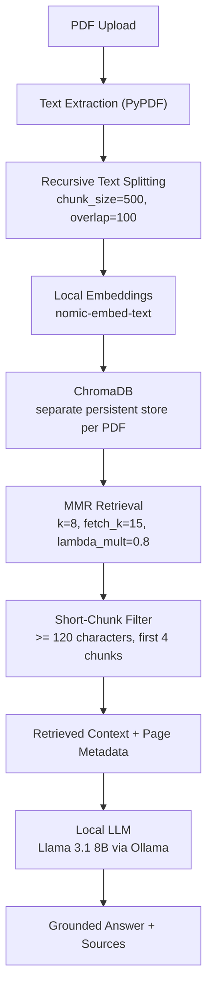

<div align="center">
  <h1>🤖 Local Multi-Document RAG Assistant</h1>
  <p>A fully local Retrieval-Augmented Generation (RAG) application for uploading, indexing, managing, and querying multiple PDF documents with persistent per-document chat history and source-grounded answers.</p>
  <p><strong>Fully local AI</strong> · <strong>Persistent multi-PDF chat</strong> · <strong>Grounded retrieval</strong> · <strong>RAGAS evaluation</strong></p>
  <p>  <a href="https://github.com/MohammadElayyan117/local-multi-document-rag-assistant">Source Code</a> · <a href="https://www.linkedin.com/in/mohammadelayyan1/">LinkedIn</a></p>
  <p><a href="#features">Features</a> · <a href="#architecture">Architecture</a> · <a href="#benchmark-results">Benchmark Results</a> · <a href="#installation">Installation</a></p>
</div>

<table>
  <tr>
    <th align="center">Benchmark Questions</th>
    <th align="center">Compared Variants</th>
    <th align="center">RAGAS Metrics</th>
    <th align="center">Unanswerable Fallback</th>
  </tr>
  <tr>
    <td align="center"><strong>30</strong></td>
    <td align="center"><strong>6</strong></td>
    <td align="center"><strong>4</strong></td>
    <td align="center"><strong>4 / 4</strong></td>
  </tr>
</table>

---

## Application Screenshot

<p align="center">
  
</p>

## Features

| Document Management & Experience | Retrieval & AI |
| :--- | :--- |
| Upload and manage multiple PDF documents | Source-grounded answers with page references and retrieved text |
| Persistent local document storage | MMR (Maximal Marginal Relevance) retrieval |
| Separate ChromaDB collection for each PDF | Short-chunk filtering to reduce low-value context |
| Persistent chat history for each document | Grounded prompt with a fixed fallback answer when the context does not contain the answer |
| Switch between documents without losing previous conversations | Local LLM inference with Ollama |
| Clear current chat and delete current document controls | Local embeddings with `nomic-embed-text` |
| No cloud API required for the core RAG pipeline | RAGAS-based evaluation and benchmark |

## Tech Stack

| Application | Retrieval & Models | Evaluation |
| :--- | :--- | :--- |
| `Python 3.12` · `Streamlit` · `PyPDF` | `LangChain` · `Ollama` · `Llama 3.1 8B` · `nomic-embed-text` · `ChromaDB` | `RAGAS` |

## Architecture



<details>
<summary>View the original plain-text architecture</summary>

```text
PDF Upload
   |
   v
Text Extraction (PyPDF)
   |
   v
Recursive Text Splitting
(chunk_size=500, overlap=100)
   |
   v
Local Embeddings
(nomic-embed-text)
   |
   v
ChromaDB
(separate persistent store per PDF)
   |
   v
MMR Retrieval
(k=8, fetch_k=15, lambda_mult=0.8)
   |
   v
Short-Chunk Filter
(>= 120 characters, first 4 chunks)
   |
   v
Retrieved Context + Page Metadata
   |
   v
Local LLM
(Llama 3.1 8B via Ollama)
   |
   v
Grounded Answer + Sources
```

</details>

## Project Highlights

The application is designed as a general multi-document RAG system rather than a single-PDF demo. Each uploaded PDF is identified by a content hash, saved locally, indexed once, and assigned its own persistent vector database and chat history.

When the app is restarted, previously saved documents and conversations are restored automatically.

---

## RAG Evaluation

RAGAS is used in a separate evaluation environment to avoid dependency conflicts with the main application environment.

The first evaluation script, `evaluation/evaluate_rag.py`, scores a single question saved by the app. An early run on the question "What is ROS 2?" gave:

```text
Faithfulness:       1.0000
Response Relevancy: 0.8931
```

> This is a single-question sanity check, not a benchmark.

`Faithfulness` measures whether the generated answer is supported by the retrieved context.

`Response Relevancy` measures how directly the generated response answers the user's question.

## Benchmark

To measure the pipeline on more than one question, a small benchmark was added:

- `golden_set.json`: 30 questions with reference answers, written from one public university lecture PDF on ROS 2 (the PDF is not included in this repository)
- 20 factual questions, 6 multi-item questions, and 4 questions whose answer is not in the document
- RAGAS metrics: Faithfulness, Response Relevancy, Context Precision, and Factual Correctness
- Local judge model: `llama3.1:8b` via Ollama
- Unanswerable check: how often the model returns the fixed fallback instead of inventing an answer

Variants compared:

- `final`: current pipeline (full grounded prompt, short-chunk filter, 4 context chunks, chunks 500/100)
- `baseline_a`: simpler prompt without the document name and without the multi-item instruction
- `baseline_b`: no short-chunk filter
- `final_k6`: 6 context chunks instead of 4
- `final_partial`: extra prompt rule for partially covered lists
- `final_chunk800`: chunk size 800, overlap 150

> The two baselines were created for this comparison. They are not historical versions of the app.

---

## Benchmark Results

Prompt and filtering comparison on the 26 answerable questions (mean of 2 runs):

| Variant | Faithfulness | Relevancy | Context Precision | Factual Correctness |
| :--- | ---: | ---: | ---: | ---: |
| baseline_a | 0.894 | 0.794 | 0.861 | 0.700 |
| baseline_b | 0.917 | 0.879 | 0.827 | 0.759 |
| final | 0.885 | 0.881 | 0.861 | 0.753 |

Additional experiments on all 30 questions (1 run):

| Variant | Faithfulness | Relevancy | Context Precision | Factual Correctness |
| :--- | ---: | ---: | ---: | ---: |
| final | 0.838 | 0.767 | 0.861 | 0.739 |
| final_k6 | 0.865 | 0.746 | 0.851 | 0.747 |
| final_partial | 0.886 | 0.780 | 0.861 | 0.737 |
| final_chunk800 | 0.880 | 0.709 | 0.853 | 0.696 |

In the second block, Faithfulness and Relevancy include the 4 unanswerable questions. RAGAS gives a fallback answer a Relevancy of 0 by design, so these values are lower than in the first block. Compare rows within a block, not across blocks.

Unanswerable questions: all variants returned the fixed fallback answer on 4 out of 4.

Main findings:

- The grounded prompt raised Response Relevancy from about 0.79 to 0.88 on answerable questions, consistently across both runs
- Factual Correctness improved from about 0.70 to 0.75, but this is less stable
- Short-chunk filtering slightly raised Context Precision (0.827 to 0.861), a difference of about one question
- Faithfulness did not separate the variants because run-to-run noise was as large as the differences
- None of the three extra experiments improved the scores beyond noise (about 0.02 between evaluations)
- Chunk size 800 retrieved a full list that the default setup missed, but the model also answered "not found" on two answerable questions
- The extra prompt rule did not stop the 8B model from inventing items for a partially retrieved list

## Benchmark Limitations

- One source PDF and 30 questions (26 answerable)
- The judge is a local 8B model from the same family as the application model, so scores are noisy
- Some low scores on correct answers came from the judge, not from the pipeline
- The questions were inspected while analysing failures, so a held-out question set is still needed
- `generate_answers.py` re-implements the pipeline instead of importing the Streamlit app
- No prompt-injection or adversarial testing has been done yet

---

## Installation

### 1. Clone the repository

```bash
git clone https://github.com/MohammadElayyan117/local-multi-document-rag-assistant.git
cd local-multi-document-rag-assistant
```

### 2. Create a virtual environment

Windows PowerShell:

```powershell
python -m venv .venv
.\.venv\Scripts\Activate.ps1
```

### 3. Install Python dependencies

```powershell
pip install -r requirements.txt
```

### 4. Install Ollama

Install Ollama on your system, then pull the required models:

```powershell
ollama pull llama3.1:8b
ollama pull nomic-embed-text
```

You can verify the installed models with:

```powershell
ollama list
```

## Run the Application

```powershell
python -m streamlit run app.py
```

Then open the local Streamlit URL shown in the terminal, usually:

```text
http://localhost:8501
```

## Run RAGAS Evaluation

Create a separate evaluation environment to avoid dependency conflicts with the main app:

```powershell
python -m venv .venv_eval
.\.venv_eval\Scripts\python.exe -m pip install -r requirements-eval.txt
```

After the app has generated `evaluation_sample.json`, run:

```powershell
.\.venv_eval\Scripts\python.exe .\evaluation\evaluate_rag.py
```

## Run the Benchmark

Generate answers in the main environment:

```powershell
python evaluation\generate_answers.py --pdf path\to\your_document.pdf
```

Score them in the evaluation environment:

```powershell
.\.venv_eval\Scripts\python.exe .\evaluation\score_ragas.py --runs 2
```

Both scripts accept `--variants` to run only some variants, for example `--variants final final_k6`.

`golden_set.json` is specific to the original lecture PDF. For another document, write a new golden set with the same fields: `question`, `reference`, `answerable`, and `source_page`.

## How to Use

1. Upload a PDF from the sidebar.
2. Wait until the document is indexed and marked ready.
3. Ask questions about the selected PDF.
4. Expand **Sources** to inspect the retrieved text and page numbers.
5. Upload additional PDFs and switch between them using **Saved Documents**.
6. Each document keeps its own chat history.
7. Use **Clear Current Chat** to clear only the selected document's conversation.
8. Use **Delete Current Document** to remove the selected PDF, its vector database, and its saved chat.

## Local Data

The application stores runtime data locally in:

```text
uploaded_pdfs/
chroma_uploads/
document_registry.json
chat_histories.json
evaluation_sample.json
```

These files are excluded from Git through `.gitignore`, together with the benchmark PDF, `evaluation/answers.json`, and `evaluation/chroma_bench/`.

## Current Limitations

- Best suited for PDFs that contain extractable text.
- Image-only or scanned PDFs are not yet processed with OCR.
- Retrieval quality depends on the quality and structure of the source PDF.
- Lists that span several chunks can be incomplete or partly invented by the small local model.
- The current implementation is designed for local use with Ollama.

---

## Project Structure

```text
RAG_LangChain_Project/
|
|-- app.py
|-- README.md
|-- requirements.txt
|-- requirements-eval.txt
|-- .gitignore
|
|-- assets/
|   `-- app_screenshot.png
|
|-- evaluation/
|   |-- evaluate_rag.py
|   |-- generate_answers.py
|   |-- score_ragas.py
|   |-- golden_set.json
|   |-- results.csv
|   |-- summary.csv
|   |-- results_v2.csv
|   `-- summary_v2.csv
|
|-- uploaded_pdfs/          # ignored by Git
|-- chroma_uploads/         # ignored by Git
|
|-- document_registry.json  # ignored by Git
|-- chat_histories.json     # ignored by Git
`-- evaluation_sample.json  # ignored by Git
```

## Future Improvements

- OCR support for scanned PDFs
- Held-out question set and a second source document
- Stronger judge model from a different model family
- Optional reranking
- Prompt-injection tests
- Docker support
- Improved document management UI
- Exportable evaluation reports

## Purpose

This project was built as a practical portfolio project to demonstrate hands-on experience with:

- RAG system design
- LangChain
- Vector search
- ChromaDB
- Local LLM deployment
- Embeddings
- Retrieval optimization
- RAG evaluation
- Streamlit application development
- Persistent local application state

---

## Author

**Mohammad Ahmad Elayyan**  
Intelligent Systems Engineering Graduate  
GitHub: [@MohammadElayyan117](https://github.com/MohammadElayyan117)  
LinkedIn: [mohammadelayyan1](https://www.linkedin.com/in/mohammadelayyan1/)

<p align="right"><a href="#-local-multi-document-rag-assistant">Back to top ↑</a></p>
